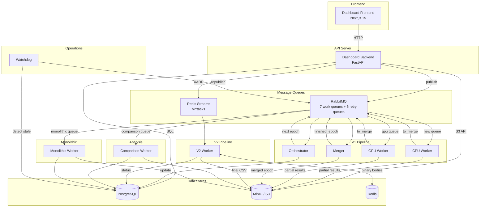
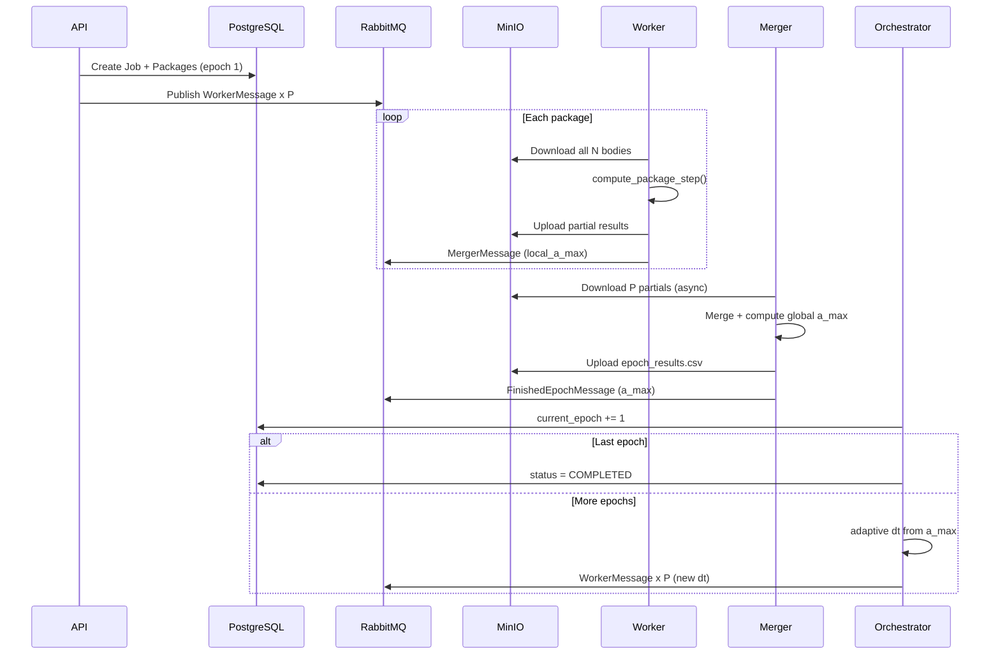
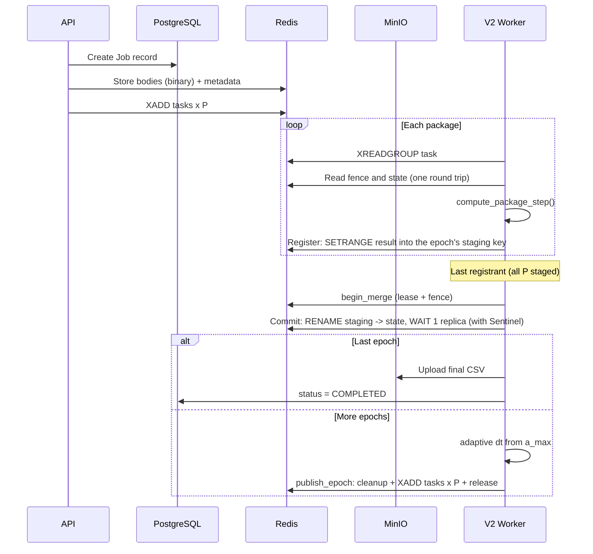

# KubeNBody

KubeNBody runs gravitational N-body simulations on Kubernetes. Jobs are submitted from a web dashboard or a REST API and computed with direct summation or a Barnes-Hut tree and one of five integrators, on CPU (Numba) or GPU (PyCUDA), in a single worker or distributed over stateless workers. Workers can be lost at any time without changing the result. Results can be replayed in 3D, downloaded as CSV and compared job to job.

A read-only demo of the dashboard, with recorded jobs and comparisons, runs in the browser at https://kubenbody.github.io/KubeNBody-demo/.

- **Execution**: monolithic workers and two distributed pipelines, V1 (RabbitMQ and S3, with a dedicated merger) and V2 (Redis Streams, where the worker that completes an epoch commits it under a lease that another worker takes over if it dies). Jobs resume after pod or node loss and can be paused.
- **Numerics**: direct O(N^2) or Barnes-Hut O(N log N) forces, simple and symplectic Euler, velocity Verlet, RK4 and Forest-Ruth, adaptive timestep, on CPU or GPU.
- **Analysis**: energy, momentum and angular-momentum diagnostics per epoch, job-to-job comparison, 3D replay, CSV download.
- **Deployment**: one Kustomize base with overlays for GKE, AKS and EKS, Terraform for each cloud, Docker Compose for a local stack.
- **Observability**: Prometheus metrics, Loki logs, Tempo traces and provisioned Grafana dashboards.

Terms used below: an *epoch* is one integration step of the whole system. A *monolithic* job runs every epoch on one worker. A *distributed* job splits the bodies into *packages* (`package_size` bodies each), and every epoch each package is advanced by a task that any worker can take, through the V1 pipeline (`/api/jobs`) or V2 (`/api/v2/jobs`).

## Quick start (local)

Needs Docker with Compose, about 8 GB of memory for the containers, and internet access for the first build (base images, Python and npm packages, the dashboard's web font), which takes several minutes. From the repository root:

```bash
cd code
cp .env.example .env                # set DEFAULT_USER_PASSWORD (8 to 128 characters) and JWT_SECRET_KEY
docker compose up -d --build
```

Open the dashboard at http://localhost:8501 and log in as `user` with that password. Upload an initial-condition file (for example `code/data/demo/figure_eight_3body.csv`, the figure-eight three-body orbit), submit a job from it and follow it in the job view.

| Service | Address |
|---|---|
| Dashboard | http://localhost:8501 |
| API (OpenAPI docs at `/docs`) | http://localhost:8000 |
| Grafana (traces; logs and metrics only in a cluster), user `admin`, password `admin` | http://localhost:3000 |
| MinIO console, user `user`, password `password` | http://localhost:19001 |
| RabbitMQ management, user `user`, password `password` | http://localhost:15672 |
| Adminer: system PostgreSQL, server `db`, user `user`, password `password`, database `nbody` | http://localhost:18080 |

`docker compose down` stops the stack and keeps its data, `docker compose down -v` deletes the data too.

An input file is a CSV with the header `n,idBody,m,x,y,z,vx,vy,vz`, one body per row, in units with G = 1: `n` numbers the rows, `idBody` is a unique integer id, the masses are positive. The same nine columns separated by spaces are read too, and a file can be up to 100 MB. [`code/data/`](code/data/README.md) holds example models. `code/src/ic_generators.py` makes more, seeded: for example, from `code/`, `PYTHONPATH=src poetry run python -c 'import ic_generators as g; g.to_csv("plummer_1000.csv", *g.plummer_sphere(1000, seed=1))'`.

The local stack runs CPU workers only: a job submitted with "Use GPU" waits for a GPU worker, which only the cluster deployments have. It runs 15 containers, its ports are published on `127.0.0.1` only (the credentials above are public), and Redis is capped at 2 GB.

### The figure-eight example

The three-body figure-eight orbit of `code/data/demo/figure_eight_3body.csv` integrated three ways: in the dashboard, submit three monolithic jobs from that file with 19,000 epochs, a time step of 0.001 and a snapshot every 64 epochs, one each with Velocity Verlet, Simple Euler and RK4, then compare them on the Compare page (energy drift, and position error against the first). Each takes seconds on a laptop. The same through the API, from the repository root:

```bash
(cd code && poetry install --with tools && NBODY_USER=user NBODY_PASS=<password> PYTHONPATH=.. \
    poetry run python -m scripts.run_demo_jobs --api http://localhost:8000 --inputs data/demo \
    --out demo_job_ids.json --only A1,A2,A3)
```

### Using the API

The dashboard is a client of the REST API, documented at http://localhost:8000/docs. A job from the command line, from the repository root. An uploaded file joins the file library and a second upload with the same name is refused: reuse it with `-F file_id=<id>` (ids from `GET /api/files`) in place of `-F file=@...`, or add `-F force_new=true`.

```bash
API=http://localhost:8000
TOKEN=$(curl -s -X POST $API/api/auth/login -H 'Content-Type: application/json' \
    -d '{"username": "user", "password": "<password>"}' | python3 -c 'import json,sys; print(json.load(sys.stdin)["access_token"])')
curl -s -X POST $API/api/jobs -H "Authorization: Bearer $TOKEN" \
    -F file=@code/data/demo/figure_eight_3body.csv -F job_type=monolithic -F num_epochs=19000 \
    -F time_step=0.001 -F snapshot_interval=64 -F integration_method=velocity_verlet      # -> {"job_id": ...}
curl -s $API/api/jobs/<job_id>/status -H "Authorization: Bearer $TOKEN"
curl -s -o results.csv.gz $API/api/jobs/<job_id>/results -H "Authorization: Bearer $TOKEN"
```

The results of a completed job are its snapshots, a gzipped CSV of the input columns plus `epoch` and the accelerations `ax,ay,az`. A V2 job is submitted to `/api/v2/jobs` with the same fields plus `package_size` (`gpu_enabled` in place of `use_gpu`) and, optionally, `partition_strategy`, which assigns the bodies to packages once, at job creation: `linear` (file order, the default), `random`, `spatial` (Morton order) or `orb` (orthogonal recursive bisection). A V2 job whose Redis state was lost is marked failed by the watchdog; `POST /api/v2/jobs/<job_id>/recover` restores it from its latest snapshot under a new generation. They live in MinIO (S3): uploaded inputs in the `inputfiles` bucket, epoch results in `epochresults`, and per-package partial results of the V1 pipeline in `partialresults`. PostgreSQL holds the jobs and their progress. A job's `metadata` (in `GET /api/jobs/<job_id>`) records the software environment of the run and, under `compute_hosts`, the CPU model and node of every worker that computed it: the force kernels are compiled for the host CPU, so runs agree bitwise only on the same CPU model.

## Architecture

The system follows a message-driven microservices architecture with two execution pipelines:

- **V1 (RabbitMQ)**: Job is split into packages distributed across workers. A merger combines partial results per epoch, and an orchestrator advances epochs. Supports distributed and monolithic (single-worker) execution.
- **V2 (Redis Streams)**: Consumer-group-based distributed processing with in-memory coordination for lower latency. Each worker writes its result into its slice of a staging key, and the last registrant commits the epoch by renaming the staged state into place, under a renewable merge lease and a generation fence. If a worker dies, its task is reclaimed and an interrupted commit is taken over by another worker, so the job continues without a restart or a rollback of the other workers.



## V1 vs V2 Pipelines

| | V1 (RabbitMQ) | V2 (Redis Streams) |
|---|---|---|
| **Communication** | RabbitMQ queues + S3 CSV files | Redis Streams + binary in-memory |
| **Merge** | Dedicated merger service | The last worker to finish an epoch commits it with one Redis rename of the staged state |
| **Network per epoch** | O(P * N) -- each worker downloads all bodies from S3 | O(P * N) -- each task reads the full state from Redis (binary, in memory, so a smaller constant than V1's CSV from S3) |
| **Adaptive timestep** | Supported | Supported |
| **Pause/Resume** | Supported (monolithic + distributed) | Supported |
| **Fault tolerance** | Durable queues with delayed retry queues, DB lease and watchdog republishing for monolithic jobs | Generation-fenced commit, 45 s stale-task reclaim, 30 s merge lease with takeover, snapshot recovery |
| **Outages** | S3 / PostgreSQL outages retried without counting against the job's retry budget | same |
| **Best for** | Every epoch persisted in object storage | Lower latency per epoch; a lost worker costs only its in-flight task |

V1 is the default (`/api/jobs`). V2 is accessed via `/api/v2/jobs`.

### V1 Flow (per epoch)



### V2 Flow (per epoch)



## Tech Stack

| Component | Technology |
|-----------|-----------|
| Backend API | FastAPI, Uvicorn |
| Database | PostgreSQL (Peewee ORM) |
| Message Queue | RabbitMQ (V1), Redis Streams (V2) |
| Object Storage | MinIO (S3-compatible) |
| V2 coordination and epoch state | Redis (with Sentinel in the cluster) |
| Physics Engine | NumPy + Numba JIT (CPU), PyCUDA (GPU) |
| Frontend | Next.js 15, React Three Fiber, TanStack Query |
| Infrastructure | Terraform and Kustomize for GKE, AKS and EKS, Docker Compose locally |
| Monitoring | Prometheus metrics, OpenTelemetry traces, Grafana LGTM stack with Alloy (scaled to zero on GKE and AKS) |

## Physics Algorithms

### Force Calculation
- **Direct** (`O(N^2)`): Pairwise gravitational force. Exact but computationally expensive.
- **Barnes-Hut** (`O(N log N)`): Octree-based monopole approximation. Accuracy controlled by opening angle `theta` (default 0.5). Details in [docs/barnes_hut.md](docs/barnes_hut.md).

### Integration Methods
- **Symplectic Euler** (1st order, default) -- fast, energy-bounded
- **Simple Euler** (1st order) -- baseline comparison
- **Velocity Verlet** (2nd order, symplectic) -- good energy conservation
- **RK4** (4th order) -- high accuracy, 4x force evaluations
- **Forest-Ruth** (4th order, symplectic) -- best long-term stability

These orders and symplecticity hold for the monolithic workers. The distributed pipeline exchanges state once per step, so its multi-stage methods (`gvv_*`, `grk4_*`, `gfr_*`; the plain names `velocity_verlet`, `rk4` and `forest_ruth` submitted to it are their `*_linear` variants) evaluate the other packages at a predicted background: the guaranteed global order is min(p+1, q) for predictor order p and method order q, so second order with the linear predictor (`*_linear`) and third with the acceleration predictor (`*_accel`). They are not symplectic, conserve momentum only to the predictor order and depend on the package count and partition. The exception is `gvv_accel`, which is bitwise identical to monolithic velocity Verlet. Symplectic and simple Euler are single-stage and unaffected.

### Adaptive Timestepping
Softening-length criterion (GADGET-style, Power et al. 2003): `dt = eta * sqrt(softening / a_max)`, with the softening length `sqrt(softening_sq)`, clamped to `[dt_min, dt_max]`. Supported in both V1 and V2 pipelines.

## GPU Acceleration

GPU workers use PyCUDA with CUDA 12.8 for force computation, built from `Dockerfile.gpu`. They need an NVIDIA GPU with a driver for CUDA 12.8 (R570 or later) and run only in the cluster deployments, on their GPU node pools (T4 GPUs as configured, whose float64 throughput is a small fraction of float32).

- **Supported**: Direct O(N^2) force calculation, all 5 integrators, adaptive timestepping (monolithic and distributed)
- **Not supported on GPU**: Barnes-Hut tree algorithm
- **Memory**: Tiled shared-memory kernel for coalesced access
- **Precision**: float64 by default, float32 per GPU worker deployment with `NBODY_GPU_FLOAT32=1` (not per job)

GPU jobs are routed to dedicated GPU workers: the RabbitMQ queues `gpu_distributed` and `gpu_monolithic_jobs` (V1 and monolithic) and the Redis stream `v2:gpu_tasks` (V2).

## Simulation Comparison & Analysis

Built-in comparison system for analyzing simulation accuracy:

- **Conservation metrics**: Energy drift, momentum conservation, angular momentum per epoch
- **Job-to-job comparison**: Position/velocity RMSE between runs with different algorithms or parameters
- **Persistent comparisons**: Background jobs stored in S3, with staleness detection

API: `GET /api/comparison/jobs/{id}/metrics`, `POST /api/comparison/compare`, `POST /api/comparison/saved`

## Deploying to a cloud

The manifests are one cloud-neutral base, `configs/base/`, and an overlay per cloud with only what differs (storage classes, secret store, workload identity, node pools, registry, backups). Each cloud has a Terraform root and a Makefile in `infra/<cloud>/`:

| Cloud | Terraform and Makefile | Manifests | Guide |
|---|---|---|---|
| Google GKE | `infra/gcp/` | `configs/gcp/` | [infra/gcp/README.md](infra/gcp/README.md) |
| Azure AKS | `infra/azure/` | `configs/azure/` | [infra/azure/README.md](infra/azure/README.md) |
| AWS EKS | `infra/aws/` | `configs/aws/` | [infra/aws/README.md](infra/aws/README.md) |

The steps are the same on each cloud, with small differences the guides spell out:

| Step | GKE and AKS | EKS |
|---|---|---|
| Terraform state store, once | `make bootstrap` | `make bootstrap` |
| Network, registry, cluster, identities, secret store | `make init`, `make apply` | `make init`, `make base` (the cluster comes with `make up`) |
| Third-party images | pulled from their registries | `make mirror-images` (copied into ECR) |
| Deployment values into `configs/<cloud>/session/` (git-ignored) | `make configure` | done by `make up` |
| Application secrets | `make init-secrets` | `make init-secrets` |
| Images | `scripts/build-and-push.sh --gcp` / `--azure` | `scripts/build-and-push.sh --aws` |
| Deploy in stages (base, operators and their CRDs, secret store, everything else) | `make deploy-k8s` | `make up` |

`make init-secrets` writes every application secret: random passwords and keys, fixed user names. Set `NBODY_DEFAULT_USER_PASSWORD` to choose the dashboard password, else one is generated and the script prints how to read it.

**Images.** No prebuilt images are published: `build-and-push.sh` builds the application images from this repository and pushes them to the cloud's registry. To take them from another registry you pushed them to (built once for several clusters), run `make configure NBODY_IMAGE_REGISTRY=<registry>` (on EKS `make up NBODY_IMAGE_REGISTRY=<registry>`, on every `make up`). The choice is kept for later `make configure` runs, and `NBODY_IMAGE_REGISTRY=none` goes back to the cloud's registry. Only the application images move, the third-party images stay where they are.

**After a deploy.** The worker Deployments start at zero replicas and the worker node pools empty. Scale the pool (`make scale-worker-cpu N=1`, `make scale-gpu N=1`, see the cloud's guide), then the workers you need, e.g. `kubectl --context <cluster context> -n nbody scale deployment worker-monolithic-cpu worker-distributed-v2-cpu --replicas=1` (GPU: `worker-monolithic-gpu`, `worker-distributed-v1-gpu`, `worker-distributed-v2-gpu`). Scale them back to zero before the pool. The dashboard is at `http://<EXTERNAL-IP>` of `kubectl --context <cluster context> -n nbody get svc dashboard-frontend-svc` (a host name on EKS, also printed by `make endpoints`): log in as `user` with the password from `make init-secrets`.

**Exposure.** The dashboard is a public LoadBalancer over plain HTTP, protected by its login. Grafana is limited to your IP on GKE and EKS (detected by `make configure`, or `ADMIN_CIDR`) and internal on AKS, and it is deployed scaled to zero on GKE and AKS: start it with `kubectl --context <cluster context> -n monitoring scale deployment/lgtm --replicas=1` (a later deploy resets it, and the workers, to the manifests' replicas). Put TLS in front of the dashboard (an ingress with a certificate) before using it beyond a test.

**Pod security.** The application pods run as their images' unprivileged users, without privilege escalation or capabilities and with the runtime's seccomp profile (`configs/base/apps/security/`). NetworkPolicies (`configs/base/apps/network-policies.yml`) keep the internet-facing frontend from everything but the API: they are enforced on GKE, whose clusters run Calico, and are inert on AKS and EKS until their network policy support is turned on.

**Third-party images.** The deployments pull images under their own terms, run unmodified as separate containers: Crunchy Data's PostgreSQL operator, PostgreSQL, pgBackRest and pgBouncer images are free for development and testing, production use needs a Crunchy Data subscription (see [NOTICE](NOTICE)). Redis (RSALv2/SSPLv1/AGPLv3), MinIO and the Grafana stack (AGPL-3.0) have their own licences too.

`make render` checks an overlay offline: it renders every stage with example values and, when `kubeconform` is installed, validates the result.

`configs/base/` is laid out as:
- `infra/`: PostgreSQL (Crunchy PGO, with pgBackRest backups), RabbitMQ, MinIO, Redis with Sentinel
- `apps/`: API, dashboard, monolithic, V1 and V2 workers (CPU and GPU), orchestrator, merger, watchdog, comparison worker
- `monitoring/`: LGTM stack, Alloy DaemonSet, Grafana dashboards
- `secrets/`: ExternalSecret definitions (each overlay points them at its cloud's secret store)

## Development

```bash
cd code
poetry install --with tools         # Python 3.10 to 3.12 (the images use 3.11): services, tests, scripts
poetry run ruff check .
poetry run pytest                   # CPU tests (redis-server on PATH for the coordination tests)

cd web-dashboard
npm install
npm run dev                         # hot reload (stop the compose `dashboard` first: same port)
npm run type-check && npm test
```

The compose services mount `code/src/`, so the API reloads on edits. Restart a worker to pick up changes.

The tests cover physics correctness (conservation laws, integrator convergence orders, Barnes-Hut accuracy, adaptive timestep behaviour, bitwise reference trajectories), the V2 epoch protocol against a real `redis-server` (fencing, crash points with takeover, staged commit, replica reads), fault handling (leases, watchdog, outage classification), the API and the comparison service. Tests that need a `redis-server` or a CUDA device are skipped where those are missing. The bitwise reference trajectories hold for one processor model (fast-math kernels compiled for the host), so they are checked only on the machines recorded in `code/tests/data/trajectories/`. Record your own from `code/` with `PYTHONPATH=src:tests poetry run python -m trajectories` (`--gpu` for a GPU). CI runners are not among the recorded machines, so CI skips those tests. The CI workflow (`.github/workflows/ci.yml`) runs the linter, the tests, the dashboard checks, `make render` for every cloud and `terraform validate`.

See [CONTRIBUTING.md](CONTRIBUTING.md) for adding an integrator, a compute backend, a message backend or a cloud.

### Diagnostic switches

Off by default, set as environment variables of the workers:

- `NBODY_TIMING_DETAIL=1` (V2 workers): a JSON record of the phase durations of every task and merge, in the Redis list `v2:timings:<job id>` (read it with `LRANGE`, kept for 7 days).
- `NBODY_SNAPSHOT_DIAGNOSTICS=1`: conservation checks at every snapshot, an O(N^2) pass each. The monolithic worker logs the energy and centre-of-mass drift. V2 stores the energy, momentum and angular momentum in the Redis hash `v2:diag:<job id>` (kept 30 days). V1 distributed ignores it.
- `NBODY_FAULT_INJECT=point@epoch[@job][@freeze=S]` (V2 workers): kills, or freezes, the worker that reaches a named point of the epoch commit, for testing fault tolerance. The points are listed in `fault_point` in `code/src/workers/distributed_worker_v2.py`. Never set it in production.
- `NBODY_GPU_FLOAT32=1` (GPU workers): float32 kernels instead of float64.

### Worker settings

Set as environment variables of the workers; the defaults suit the base manifests:

- `NBODY_V2_REPLICA_READS` (V2 workers, off in the code, on in `configs/base`): odd-numbered packages read the epoch state from a Redis Sentinel replica, which halves the primary's outgoing traffic. A replica that lags or is down falls back to the primary.
- `NBODY_V2_STALL_MINUTES` (watchdog, 30) and `NBODY_V2_STALL_ACTION` (`fail`, or anything else to only log): a V2 job that commits no epoch for that long is marked failed, so that it can be recovered.
- `NBODY_NACK_RETRY_DELAY_MS` (V2, 15000) and `NBODY_NACK_RETRY_MAX_MS` (300000): the delay before a task a worker gave up on is redelivered, growing fourfold per delivery.
- `NBODY_V1_RETRY_DELAY_MS` (15000) and `NBODY_MAX_TASK_DELIVERIES` (5): the delay before a failed V1 or monolithic message is redelivered, and how often before the job fails.
- `NBODY_GPU_ARCH=sm_<n>` (GPU workers): compile the CUDA kernels for this architecture instead of the detected one, for a toolkit older than the GPU.

### Static demo

`code/web-dashboard/demo-data/` holds a recorded set of jobs and comparisons, from which the dashboard builds a read-only static site that needs no backend: `npm run build:demo` (output in `out/`, `NEXT_PUBLIC_BASE_PATH` for a sub-path) and `npm run preview:demo`. `scripts/run_demo_jobs.py` runs the demo jobs on a stack and `scripts/export_demo_fixtures.py` records them again, and `code/web-dashboard/scripts/publish-static-demo.sh` copies a build into a GitHub Pages clone. The hosted demo, https://kubenbody.github.io/KubeNBody-demo/, is published this way from a clone of https://github.com/KubeNBody/KubeNBody-demo.

## Project structure

```
├── code/
│   ├── src/
│   │   ├── api.py                  # FastAPI app, router registration, CORS
│   │   ├── routes/                 # API: auth, jobs, results, comparison, files, monitoring
│   │   ├── models.py               # Peewee ORM models
│   │   ├── physics.py              # Numba JIT: forces, 5 integrators, adaptive dt
│   │   ├── physics_gpu.py          # PyCUDA engine (kernel sources in physics_gpu_kernels.py)
│   │   ├── barnes_hut.py           # O(N log N) octree with monopole expansion
│   │   ├── integrators.py          # Integration method registry
│   │   ├── orchestrator.py         # V1 epoch orchestration
│   │   ├── merger.py               # V1 partial result merging
│   │   ├── watchdog.py             # Stale job detection and republishing
│   │   ├── comparison_worker.py    # Background comparison processor
│   │   ├── ic_generators.py        # Seeded initial-condition generators
│   │   ├── tracing.py              # OpenTelemetry setup
│   │   ├── config/                 # Pydantic settings (DB, MQ, Redis, S3, auth, logging, API)
│   │   ├── services/               # Comparison service (Numba JIT metrics), cache
│   │   ├── workers/                # Distributed and monolithic workers
│   │   │   ├── base/               # Compute and message backend interfaces
│   │   │   └── backends/           # CPU, GPU, RabbitMQ and Redis implementations
│   │   ├── v2/                     # Redis pipeline: API, Lua scripts, recovery, binary format
│   │   └── utils/                  # Metadata, job helpers, file parsing, snapshot loading
│   ├── migrations/                 # Database schema migrations (run by the API at startup)
│   ├── tests/                      # Physics, coordination, fault-tolerance and API tests
│   ├── data/                       # Example initial conditions
│   ├── web-dashboard/              # Next.js dashboard
│   ├── Dockerfile, Dockerfile.gpu
│   └── docker-compose.yml          # Local stack
├── configs/
│   ├── base/                       # Cloud-neutral Kustomize base
│   └── gcp/, azure/, aws/          # Overlays per cloud
├── infra/
│   ├── common/                     # Deploy, render and secret scripts shared by the clouds
│   └── gcp/, azure/, aws/          # Terraform and Makefile per cloud
└── scripts/                        # Image build and push, demo inputs and jobs
```

## Citation and licence

If you use KubeNBody in your work, please cite it as described in [CITATION.cff](CITATION.cff).

KubeNBody is licensed under the Apache License 2.0, see [LICENCE.txt](LICENCE.txt) and [NOTICE](NOTICE).

## Support

Report bugs and ask questions in the repository's GitHub issues, or e-mail pgrzesik@polsl.pl.
